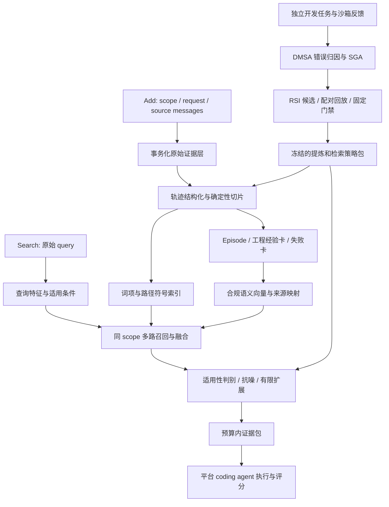

# Coding Memory 开源方法榜：DMSA + RSI 技术落地方案

日期：2026-10-22。状态：技术设计，尚未实施、部署或取得官方成绩。
本文取代此前文本赛道方案中的任务建模；共用的持久化与接口正确性诊断仍有效。

## 当前实现状态（0.2.0.dev0）

已实现本地 provenance-aware Coding Memory、有界检索和鉴权 `/add`、`/search` 子集。sparse 开发模式只用稀疏索引；competition profile 要求配置真实 text-embedding-v4 endpoint。`/v1/runs`、在线进化、官方 endpoint 验证和 1.8B 规模验证均未实现。打包目前依赖 sibling PMD skeleton。

## 1. 目标、合约与关键判断

目标：让平台的固定 coding agent 能从大量同仓库历史中，找到当前任务真正适用的
定位线索、根因证据、修复模式、失败教训和验证方法，减少无关历史造成的误导。
我们交付记忆系统，平台负责实际解题、改代码、测试与评分。

已核实的一手来源：

- https://agentmemoryleaderboard.ai/api/v1/evaluation-tracks/coding/contract
- https://agentmemoryleaderboard.ai/docs
- https://agentmemoryleaderboard.ai/api-guide
- https://agentmemoryleaderboard.ai/competition/

2026-10-22 实时合约为 `coding-v1` / `cambench-coding-relevant-noisy-300-v1`，
数据集 `cambench_code`。正式说明是 150 个软件工程任务在 relevant/noisy 下各运行
一次，共 300 次计分尝试。用户提供 99 个修复、51 个增强、四档噪声与约 1.8B tokens
作为容量和评测切片背景；四档噪声不再乘进 300，具体分配以绑定合约为准。

开源榜 embedding 使用 `text-embedding-v4`，LLM 组件使用 `gpt-4o-mini`，reranker
不限。平台 coding_model 的公开枚举是 `flash`，属于平台执行配置，不能据此将我们
的提炼模型换成其他模型。参赛方无需实现评测平台的 `/v1/runs` orchestration API。

Add 并发范围 16–64，Search 16–256；单请求最长 30 分钟。并发是容量上限，
不能拿它直接推算 QPS。正式 top_k 按请求处理，通用文档当前为 100。
Coding memory-api-v1.1 的合约能力声明接受 string/content parts，但通用文档说明
Coding 通常发字符串；适配器支持字符串及有序 text parts，拒绝非 text 类型。

接口没有承诺发送 repo checkout、commit、测试标签、文件系统或平台最终成败反馈。
因此这些字段必须可缺省；所有路径、符号和结论都从实际收到的轨迹提取，不能从
user_id 猜数据集/仓库，不能要求平台额外传 filters、rerank 或 keyword_search。

## 2. 最核心的七个技术想法

| 核心想法 | 解决的问题 | 可落地实现 | 如何验证 |
|---|---|---|---|
| 轨迹转工程经验单元 | 普通分块切断问题、行动与结果 | Episode + EvidenceSpan + ExperienceCard，保留反例与适用条件 | 对比固定长度分块的证据覆盖、解决率 |
| 来源图与工程关系分开 | 创建 lineage 不等于代码依赖 | PMD 管来源/版本；显式关系索引管同符号、同测试、同 episode | 去掉来源/关系扩展分别消融 |
| 适用性优先的抗噪检索 | 相似历史可能对应相反条件 | 精确标识符 + 稀疏 + 语义召回，条件/结果/版本再判别 | noisy 下误导记忆率与最差噪声切片 |
| 成功与失败成对存储 | 只记成功容易重复失败路径 | attempted/reported_success/verified_success/failed/unknown 状态和证据 | 删除失败记忆后的错误重复率 |
| 预算内证据组合 | top_k 里塞满重复大日志 | 选择“定位—机制—行动—验证”互补证据，限制同 episode 份额 | 相同 token 预算下证据覆盖与解题率 |
| DMSA 定向经验梯度 | 泛泛反思无法指导改进 | 从检索漏召回、错选、错版本等失败形成目标明确的 GradientSample | 对比无分类/无 SGA 的候选通过率 |
| 双层离线 RSI | 固定总结模板难持续改善 | 内层改卡片/检索策略，外层改提案器；固定裁判、独立验收 | 单层 vs 双层，固定成本配对比较 |

方法定位：**带适用条件和来源证据的工程经验记忆，通过可回放的双层离线优化，
改进它自身的提炼和检索程序。** 这些是待检验的组合假设，不能直接宣称首创或提分。

## 3. 总体架构与两条数据路径



在线数据平面只做 Add/Search 和冻结算法内的数据更新。离线改进平面只使用自有或
获许可开发任务；正式评测轨迹、评分及衍生副本不进入全局进化池。

## 4. 记忆表示：保留经验的因果链与适用边界

### 4.1 三层对象

1. **RawEvent / EvidenceSpan**：不可变原始消息、角色、原时间、顺序、字符/字节
   范围、hash、scope、session、request。原文是最终可追溯依据。
2. **Episode**：一次定位/修改/验证过程。优先按显式 tool call/result、测试输出、
   diff 边界切分；不明确时仅按消息窗口切片，不能捏造工具执行关系。
3. **ExperienceCard**：问题特征、涉及符号/路径、观察到的原因、尝试动作、结果、
   验证、适用条件、反适用条件，以及逐字段 source_refs。卡片是索引视图，原文保留。

卡片示例是设计样例，非评测数据：

```json
{
  "card_id": "exp-example",
  "scope_id": "opaque-scope",
  "episode_id": "ep-example",
  "kind": "bug_fix",
  "symptom": "空集合输入时聚合函数抛异常",
  "symbols": ["aggregate_items"],
  "paths": ["src/aggregate.py"],
  "mechanism": "未处理空迭代器的初始化分支",
  "action_summary": "为无元素输入返回契约规定的空结果",
  "outcome": "reported_success",
  "validation": [{"command": "pytest tests/test_aggregate.py", "status": "reported_pass"}],
  "preconditions": ["调用契约允许空集合"],
  "contraindications": ["API 明确要求空输入报错"],
  "source_refs": ["msg-8:120-280", "msg-9:0-95"],
  "repository_revision": null
}
```

`verified_success` 只用于存在可关联执行证据的情况；助手自称“已修好”只能是
reported_success。测试通过也只证明该命令/测试范围，不能上升为整体正确。
LLM 推断原因单独标 observed/inferred，并绑定来源；无来源的推断不作强事实。

### 4.2 修复和增强采用不同槽位

- 缺陷修复：症状 → 定位 → 根因假设 → 尝试/失败 → 改动 → 回归。
- 功能增强：需求 → 现有接口/扩展点 → 兼容约束 → 实现模式 → 测试适配。
- 不强行让增强任务具有“异常栈”；通用迁移经验不能冒充当前仓库事实。
- 失败经验含失败条件、已执行动作和观察结果；不使用“不要再犯错”等无操作性文本。

### 4.3 两种图明确分离

PMD provenance DAG 保存 `derived_from` 和版本父子关系，负责追溯、撤回、重提炼。
工程关系索引保存 `same_episode`、`mentions_symbol`、`touches_file`、`validated_by`、
`contradicts_under_condition`。工程关系允许环，不能硬塞进 provenance DAG。
只有轨迹含足够代码时才建立局部 AST 事实；缺少完整文件时不构造完整调用图。
同名符号不是同一实体，路径、语言、显式仓库信息和上下文共同消歧。

## 5. Add：可恢复、可索引、成本受控

建议流水线：鉴权/契约校验 → 幂等租约 → 规范化 → 来源切片 → 词项/符号提取
→ 有限卡片提炼 → batch embedding → 原子发布可搜索 revision → HTTP 200。

1. 请求唯一键 `(scope, request_id)`，payload hash 覆盖原始有序内容。相同键相同
   内容重复提交返回同一结果；不同内容返回明确冲突。并发租约过期后允许恢复。
2. source-first：原始事件落入 staged 状态；外部模型调用不占长 SQLite 写锁。
   只有源数据及所需索引完整后 revision 才变为 searchable，随后返回成功。
3. raw 文本独立持久化，SQLite 保存目录/来源/事务状态；FTS5 存词项，磁盘 ANN
   保存向量。多存储用 manifest 与 outbox 恢复，不伪称跨库 ACID。
4. 第一版固定使用“一条完整请求形成一个原子可见增量”；并发 Add 的提交序列由
   scope revision 明确。Search 获取一个快照，不混合半个旧索引和半个新索引。
5. 索引/嵌入失败时不返回成功。提炼阶段可以按预先披露的固定降级策略发布原文
   基线，但不能无声更换 embedding 模型或让成功写入不可检索。
6. 提炼跨 Add 的 episode 时需维护 scope/session 下的开放尾部状态，并让新卡片
   挂接旧来源；重试不重复生成。第一版可仅单请求提炼，避免隐式串写。
7. 不执行传入代码、shell 或测试，不访问轨迹中的任意 URL。代码、日志和指令
   全是数据。抽取模型只输出校验后的结构，不调用工具。

文本切片先按工具/消息/代码块边界，再按 token 预算切。初始候选配置：每块
600–1200 tokens、上下文重叠 80–160 tokens；均须按 embedding 上限与开发集验证。
代码块超长时按完整行切，保留行号、声明头和 source offset，不静默丢尾部。

提炼不采用每块一次 LLM：先确定性解析路径、栈、diff、测试摘要，按 episode 批量
抽取关键卡片，并设单请求 token/call 上限。对纯重复长日志保留原文并建立轻量索引。
嵌入按内容 hash 缓存可减少重复计算，但跨 scope 只复用无内容可检索能力的内部
计算结果，不能共享证据、经验或反馈；首次实现优先 scope-local cache。

## 6. Search：先找适用经验，再组合证据

### 6.1 查询分析

从 query 确定性识别路径、符号、异常名、失败测试、语言及显式版本；未给出的
字段保持未知。保留完整原 query，不用猜出的修复方案替换它。
可选 gpt-4o-mini 仅做检索意图/同义术语提案，受预算限制，不生成最终答案。
请求未带工作区代码时，不承诺 AST 定位或真实依赖关系判断。

### 6.2 四路召回

| 通道 | 索引内容 | 用途 |
|---|---|---|
| Exact | 完整路径、qualified symbol、错误码、测试名 | 保存代码关键字符串精度 |
| Sparse | 原文、diff、标识符及拆词、卡片字段 | 抗语义相似但符号不同的干扰 |
| Dense | 问题/机制/条件视图与来源片段 | 找措辞不同的相关经验 |
| Episode | 已命中的 episode 摘要和相邻证据 | 找回行动与结果的配对上下文 |

所有通道在 scope 内检索；ANN 采用 scope 分区或引擎原生过滤，不全库 top-k 再过滤。
先分别取候选再 RRF；初始总池 200–400，消融调参，不能用这个数覆盖外部 top_k。
精确标识符保留不拆分索引，同时增加 camelCase/snake_case 子词，避免代码 tokenizer
把路径点号、斜杠和错误码毁掉。原始日志窗口也必须可召回，防止摘要漏关键字。

### 6.3 抗噪判断

排序考虑 relevance、显式条件匹配、来源可靠性、验证强度、互补性和冗余；各项
归一化/校准后才组合。相似度与“验证过”都不是充分条件。

- 明确 scope 不同：硬拒绝；repo/version 不同只有在来源确实给出时才判。
- 明确 API 语义、运行环境或版本冲突：降权/拒绝对应行动，不删除原始历史。
- 条件未知：降低可信度，不能当作确定冲突，也不能全量过滤导致零召回。
- 高词面相似但根因不同：保留小候选给重排检查，避免直接复制补丁。
- 同一经验重复十次不变成十票支持：按 episode/source family 去重。
- 失败动作默认不给“可用修复”强信号；在失败条件匹配时可作为反例检索。
- 高频与历史时间新不代表正确；代码版本未知时不把最后写入当当前版本。
- 语义距离大可能是无关，不等于矛盾；替换当前 ConflictDetector 的错误假设。

第一版用可解释条件与 RRF/MMR；第二版再增加有延迟/许可记录的 reranker。
若采用 LLM pairwise 判断，只检查候选与来源的适用性，不能把生成的新补丁当记忆。
低置信时返回少量原文，允许空结果，不为了凑满 100 塞无关历史。

### 6.4 证据打包

按“定位线索、机制、历史行动、结果/验证”互补组合。优先一个强 episode 的完整
短链，再补互补经验，限制同一 episode 占比。预算约束可以写作：

`maximize relevance + facet_coverage - redundancy - unsupported_claims`

`subject to result_count <= top_k, token_sum <= configured_budget, exact_scope`

第一版贪心选择，不需要复杂求解器。示例输出 content：

```text
[历史经验；适用版本未知；结果：reported_success]
来源：session-7 / message-12 / span 40:320
涉及文件：src/aggregate.py；符号：aggregate_items
现象与适用条件：……
历史动作（非当前任务补丁）：……
原文证据：……
验证范围及限制：……
```

平台可能忽略额外 metadata，所以必要来源/条件需在 content 中简洁呈现；返回
稳定 id、可选 score，不把来源时间未知伪造为事件时间。保留 diff 前后文和行引用，
但不返回整段无关测试日志。内容只说明历史事实，避免“你必须执行”等代理指令。
内部 token 预算以 Coding 实际 adapter/Smoke 为准，不能沿用文本 Answer 的预算常数。

## 7. DMSA + RSI：具体改进什么，怎样产生可信反馈

### 7.1 现有组件的定位调整

| 当前组件 | 保留的价值 | 改造后的职责 |
|---|---|---|
| PMD / MemoryLayer | 来源、版本与历史追踪 | 原文→episode→卡片→策略候选的 provenance |
| GradientSample | 可追踪反馈对象 | 指向具体卡片/提炼模板/检索策略的失败诊断 |
| SGAAggregator | 多反馈聚合 | 真正跨开发样本窗口聚类，带正反样本与支持度 |
| 文本梯度更新 | 提案入口 | 生成结构化候选，禁止直接追加到事实记忆并发布 |
| 条件分支 | 条件化经验 | 同条件互斥才记冲突；不同条件生成分支 |
| ToolBP | 受限结构编辑 | 可复用 schema 校验思想；不把现有 JSON Schema 树称为源码 AST |
| MCP | 现有集成入口 | 保留兼容；比赛另加 HTTP L4 适配器 |

### 7.2 反馈来源：正式环境与开发环境分开

正式 Search 没有 gold、没有测试执行权，也没有保证收到最终分数反馈，不能构造
“我觉得成功”的训练标签。接口运行只记录最小运维指标，不挖掘跨样本经验。

离线开发使用自有/许可任务、历史轨迹和可执行仓库：固定 commit 的沙箱中让相同
coding agent 使用 baseline/candidate 记忆运行，记录补丁、测试、超时与成本。
agent/裁判与固定平台未必相同，因此端到端结果必须标“本地代理指标”，官方成绩
仍是最终依据。检索代理指标由人工标注或已知来源 trace 给出，不能用 LLM 自评替代。

诊断类别：missed_evidence、wrong_episode、identifier_confusion、inapplicable_fix、
lost_failure_context、missing_validation、version_mismatch、truncated_evidence、
redundant_noise。只有能复现且具有支持证据的诊断进入 SGA。

例如：三组开发任务均“精确测试名被 dense 召回淹没” → 聚合为 identifier_confusion
→ 提案提高 exact 候选保留配额 → 重放相关和非相关保护任务 → 通过再发布。
失败回传同时包含成功例，避免把一次失败过度推广为全局规则。

### 7.3 内层：经验与记忆程序演化

允许变化的对象分两类：

1. **经验视图候选**：分块边界、卡片模板、缺失验证字段、失败/成功区分、条件槽位。
   不改原文；重建只影响派生视图，按来源 hash 追溯。
2. **检索程序候选**：通道配额、RRF 参数、exact 保留量、关系扩展深度、条件降权、
   rerank 开关、去重阈值、facet 配额及输出预算。

使用有类型、有范围的声明式配置，不允许任意 Python、SQL、shell 或动态 import。
候选必须记录 parent_version、支持/反例、affected_components、配置 hash、模型和
索引版本、回放报告及拒绝理由。门禁未通过前不可成为 active。

### 7.4 外层：让提案器改进自身的改进方法

仅调 RRF 权重属于自动策略优化；要体现 RSI，需要进一步改进“怎样诊断和提出
记忆改进”。外层可演化 failure taxonomy 的映射提示、SGA 支持阈值、候选提案模板
和有限搜索日程。评估对象是固定预算下内层产生的候选质量/最终收益。

外层流程：固定初始系统与任务池 → 旧/新提案器各运行 K 次内层提案和相同回放预算
→ 在未用于提案的外层验证集比较其最终策略 → 固定门禁选择提案器版本。
每臂的 token、模型调用、测试时间和候选数对齐，不能让新提案器靠更多算力获胜。
第一版外层最多一轮；最终 heldout 看过后不能再据它改提案器。

始终不可演化：scope 隔离、幂等、来源真实性、数据删除、协议、模型白名单、裁判、
评分公式与发布门禁。防止优化器通过改变“什么算成功”获得伪提升。

### 7.5 晋升门禁

- 同一 corpus snapshot、任务、模型、预算和随机种子安排，baseline/candidate 成对。
- 协议、隔离、来源校验、删除、持久化零违规；NaN、缺测、超预算直接拒绝。
- 检索快门禁先淘汰明显退化；通过后才花成本做沙箱端到端门禁。
- 在预定义切片约束下至少一项可重复改善，无不可接受回归；第一版采用少量高价值
  保护任务“零已观察退化”，明确这不是总体统计保证。
- relevant/noisy、bug_fix/feature、语言/仓库、长历史、条件未知分别报告；噪声等级
  用公开/自建构造标注，不能解析正式 scope 猜等级。
- 噪声 LLM 判断需重复测量；端到端报告配对差异和不确定性，不以一次涨分发布。
- 一次只晋升一个候选；生成冻结 manifest，原子切换 active，随时回滚父版本。

### 7.6 与论文的关系

[Designer-RSI](https://arxiv.org/abs/2609.22086) 借鉴反复缺口/失败触发与匹配状态回放；
[MemEvolve](https://arxiv.org/abs/2512.18746) 借鉴记忆组件可演化；
[MetaSkill-Evolve](https://arxiv.org/abs/2607.05297) 提供快慢元技能方向；
[GEPA](https://arxiv.org/abs/2507.19457) 提供轨迹反馈优化思路。
除 Designer-RSI 已核对全文外，后三项目前核实到摘要层，不把未核实细节当实现规范。
这些论文不构成 CAMBench 提分证据；本方案双层受限策略是工程设计，需要独立验证。

正式 Full 前冻结全部程序/提示/策略/模型与初始包；评测中只运行披露的固定记忆
更新算法，不把正式数据用于离线 RSI 或跨任务共享。官方未明确禁止所有在线自适应，
这里选择冻结策略是为了与版本和数据用途约束兼容。

## 8. 1.8B tokens 下的容量与成本

这是评测总体口径，不能推成每个 scope 大小、唯一文本量或一次请求大小。容量需
按全量读写和峰值 scope 两个方向测试，并验证同源历史是否重复发送。

保守示例：若全部按 1000 tokens/块且不去重，约 180 万块；加 10% overlap 约
200 万块。若维度 d=1024、float32，裸向量约 8.2GB；d=1536 约 12.3GB，均不含
ANN、原文、FTS、卡片及备份。维度只作测算，最终按合规模型实际配置确认。
每块另加卡片向量可能近翻倍，不应默认给全部中间视图都建向量。

嵌入成本 = 实际计费输入 tokens / 1e6 × 单价；提炼成本还包含输出 tokens。
1.8B 全量 embedding 等于 1800 个百万 token 计费单位，重叠、重建和查询另计。
不能在未确认服务商单价、速率和去重率前填总金额。

建议生产起点（容量假设，非压测结论）：Linux，16–32 vCPU、64–128GB RAM、
NVMe 至少 200GB；有 reranker 时再评估 GPU。先测 1%/10% 数据的索引膨胀系数
和每百万 token 吞吐，再决定机器。外部 embedding/LLM 限速可能是主要瓶颈。

阶段性后端：

- 正确性基线：SQLite WAL + FTS5 + 小规模 scoped vector backend。
- 生产候选：原文文件/blob + SQLite 来源目录 + Qdrant 等磁盘 ANN（原生 scope
  过滤，必要时分片）；SQL FTS5 初期继续使用，压测不足再替换稀疏引擎。
- PMD 存卡片/派生节点的来源关系与轻量 payload，不让每条百万级日志都走当前
  Python 全量向量扫描。当前 MemoryLayer 搜索路径必须新增可注入后端。
- 启动恢复、索引重建和 scope 删除都按 manifest 验证；删除覆盖 ANN/FTS/缓存/
  派生数据和受控备份。scope 查询中绝不合并其他实例的历史。

初始性能目标供压测修订：Search p95 < 3s（不含可选外部 LLM 时），无全库扫描，
声明最小并发下无范围泄漏/损坏；Add 按 payload tokens 分档报告 p95 与 tokens/s，
不能给所有大小同一个 SLA。Search 缓存包含 scope/revision/query/policy/top_k。

## 9. 与现有项目结构的落地映射

保持 L1→PMD、L2→L1、L3→L2/L1、L4→下层，跨层通过 __init__ 公共 API。
以下为建议新增文件，尚未创建实现：

```text
src/dmsa/memory/
  sources.py          # 原始来源、范围与 span 公共类型
  episodes.py         # 轨迹边界、episode 数据对象
  experiences.py      # 卡片、条件与结果证据模型
  ingestion.py        # staging、幂等、revision 与恢复
  retrieval.py        # scoped 多路召回和 RRF
  evidence.py         # 来源回填、组合、预算和去重
  backends/           # sqlite/fts/vector 协议与具体后端
src/dmsa/gradient/
  diagnosis.py        # 开发轨迹错误归因
  policy.py           # 受限可进化配置
  proposals.py        # SGA 到结构化候选
  replay.py           # 快回放与沙箱执行接口
  gate.py             # 固定发布规则与报告
  meta_evolution.py   # 有界外层提案器比较
src/dmsa/mcp_server/http/
  contracts.py        # Add/Search 与 text parts 校验
  service.py          # L4 注入提炼/嵌入，编排 L1/L2
  app.py              # FastAPI 可选入口、鉴权和健康检查
benchmarks/coding/    # 独立开发数据描述、噪声生成、指标和消融
```

L1 不 import L2 的具体 LLM client；通过 Protocol 注入或由 L4 编排抽取，把校验后的
卡片交给 L1。Tree-sitter 等可选代码解析依赖放在相应 memory extra；无法解析时
回退到结构/行边界，不丢原文。开发沙箱 runner 与在线服务进程分离。

先拆超 300 行的 memory/layer.py、config.py 相关职责；不破坏现有公开路径。
重大重构按 AGENTS.md 先提交 issue；公共 API 改动写 api-reference 并有正常/异常/
边界测试；算法文档写 paper-mapping 与 algorithms。默认库仍可离线运行，生产
profile 明确拒绝 hash embedding，依赖通过 extras 安装。

## 10. 实施阶段与验收

| 阶段 | 独立交付 | 必须通过的验收 |
|---|---|---|
| P0 基线与正确性 | 先上传当前源码快照；修持久化、删除/TTL、零学习率 | 重启恢复、删除不召回、梯度边界；保留当前修改 |
| P1 可参赛服务 | scoped 原始记忆、幂等、HTTP、FTS/合规 dense | 官方契约 fake replay、并发/中断恢复、无跨 scope |
| P2 Coding 核心 | episode、工程卡片、条件抗噪、证据组合 | 对比纯 hybrid 的 evidence/noise/本地解决率 |
| P3 DMSA 优化 | 多样本诊断、SGA、内层候选和回放 gate | 拒绝退化/造假/缺测；来源不变；冻结包可回滚 |
| P4 RSI 加深 | 一轮元提案器演化 | 固定总预算优于或不劣于单层；未见集验证 |
| P5 参赛冻结 | 容量、模型、许可证、方法报告、部署与 Smoke | 固定 commit/config/index schema，Full 前完整复核 |

本期时间优先 P0–P2：没有可靠抗噪检索，递归层越多越容易放大错误。P3 可先做
检索代理回放；P4 若无充分预算与收益证据，不启用正式版本，但完整保留研究接口。
材料截止当前为 10-31 23:59 UTC+8，不能把本轮所有研究功能绑定为提交前置条件。

## 11. 评测设计与消融

开发拆分按 repository/task family 分组，避免近重复补丁和历史泄漏。
`evolution_train`、`replay_validation`、`outer_validation`、`heldout_test` 分离。
四档噪声自建时包含：无关任务、词面相似根因不同、失败尝试、相反 API 条件、旧
版本经验和重复日志；记录抽样种子和干扰来源，既测相同 token 预算也测自然增长。
这些是开发难例，不冒充官方噪声构造方法。

必须比较：

1. scoped sparse；scoped dense；hybrid（共同基础）。
2. hybrid + episode/card（检验经验结构价值）。
3. + condition/negative evidence（检验抗噪价值）。
4. + facet packing（相同输出 token 预算）。
5. + DMSA 内层 gate（相同进化预算）。
6. + 外层 RSI（相同候选数、token、测试预算）。

主要本地指标：测试解决率及 relevant/noisy 差、已知目标文件定位率、误导记忆率、
证据 Recall/nDCG、facet 覆盖、失败路径重复率、p95、外部调用成本和索引容量。
开发任务允许时跑“不提供记忆”作为负迁移参照。
官方 score 聚合不自行假定；分别报告 bug_fix/feature/noise 切片，不能用一个平均值
隐藏高噪声崩溃。不能以文件定位提升替代最终解决率。

工程性质测试包括：跨 scope 拒绝、重复写入、断电式中断恢复、并发 Add/Search
快照、删除级联、长期日志切片无丢失、卡片来源校验、恶意指令仅作数据、版本未知
不误判、来源字段不编造、gate 对 NaN/缺测/超预算拒绝。全量 pytest 覆盖率≥80%；
新模块严格 ruff/mypy，既有基线违规明确列清并分批修复，不降低门槛掩盖问题。

## 12. 当前实现状态（0.2.0.dev0）

原版已上传并冻结为 `baseline/pre-coding-rsi-20261022`，新版在
`feat/coding-memory-rsi` 分支开发。

已实现：

- Add：原文和来源切片持久化、隔离、原子写入及幂等重试。
- Search：路径/符号精确检索、FTS 稀疏检索、可选语义向量融合，按预算返回来源证据。
- RSI 内层：根据重复失败提出小幅策略调整，开发集配对回放，通过固定门禁后登记版本；服务策略需显式更新。
- HTTP：鉴权的 `/add`、`/search`，以及 `/health`；开发模式仅用稀疏检索，比赛模式接入配置的 `text-embedding-v4`。
- 修复原 MemoryLayer 的持久化接线、无效记忆召回及零学习率更新问题。

外层元进化、经验卡片/条件抽象、ANN 大规模向量索引及完整竞赛部署仍属于后续工作。
本次验证限于本地测试；未调用付费 API、运行官方评测或验证 1.8B Tokens 规模，
不能据此声称比赛得分提高。当前安装仍依赖相邻的 PMD skeleton。
