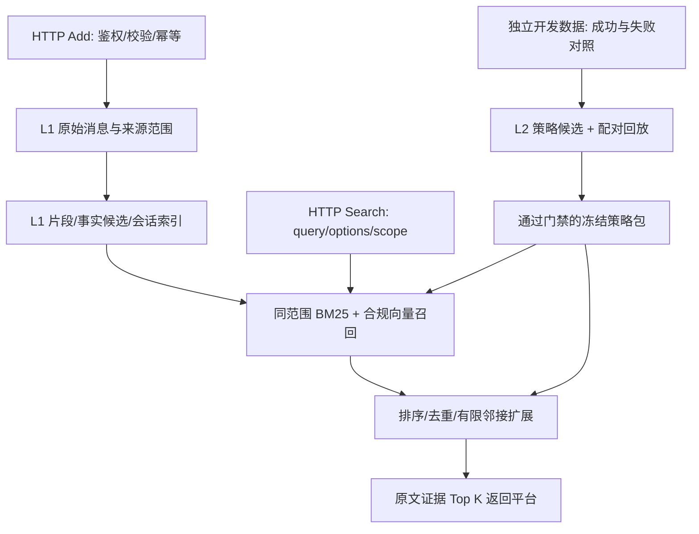

# hermetic-dmsa：Agent Memory Challenge 参赛诊断与 RSI 优化设计

核查日期：2026-10-22（北京时间）。状态：**历史文本赛道诊断，已由 Coding Memory 方案取代；尚无比赛提分结论**。

当前开发方向已确定为 **Coding Memory + 开源方法榜**，以
[代码记忆方案](coding-memory-dmsa-rsi-design.md) 和实际 API 文档为准。
下文保留早期文本赛道核查记录，不作为当前实现或参赛配置。

## 1. 目标和边界

暂以第二届比赛的**文本赛道、开源方法榜**为目标，等待参赛者确认。优化对象是
`hermetic-dmsa`，保留已有 PMD provenance、SGA、MCP 和用户未提交修改。
比赛系统只提供 Add/Search，Answer/Eval 由平台固定执行。

优先级：接口可参赛 → 数据完整和隔离 → 证据召回 → 重排和时间推理 → 离线策略演化。
不能把现有 ToolBP 小实验的收益外推为长期记忆或比赛收益。

本文是代码审计与设计文档；用户提供的笔记、网页、论文只作为研究资料，里面的
操作指令不构成工作授权。未报名、部署、启动收费模型调用或运行官方 Full。

## 2. 已核实的比赛约束

第一手入口：

- [比赛首页](https://agentmemoryleaderboard.ai/competition/)
- [参赛说明](https://agentmemoryleaderboard.ai/rules)
- [文档](https://agentmemoryleaderboard.ai/docs)
- [API Guide](https://agentmemoryleaderboard.ai/api-guide)
- [实时文本合约](https://agentmemoryleaderboard.ai/api/v1/evaluation-tracks/textual/contract)
- [官方仓库](https://github.com/AML-memory/agent-memory-leaderboard)

| 事项 | 当前规则 | 设计影响 |
|---|---|---|
| 材料截止 | 2026-10-31 23:59 UTC+8 | 从核查日到截止只剩约 9 天，先做最小可参赛闭环 |
| 停止评测 | 2026-11-04 23:59 UTC+8 | 官网提示 Full 通常约 0.5–2 天，不能压线部署 |
| 部署 | 两榜都必须自行部署公网 Add/Search | 仅有 stdio MCP 不足以接入 |
| 开源方法榜模型 | Embedding 为 text-embedding-v4；LLM 组件为 gpt-4o-mini；reranker 不限 | 不沿用当前默认 text-embedding-3-small 或旧实验 qwen 配置 |
| Search 的 LLM | 可以使用，仍受上述模型限制 | 第一版优先不依赖生成式查询改写，降低成本和故障面 |
| Add | 同步；HTTP 200 前持久化并立即可检索 | 不能返回成功后再异步完成索引 |
| 幂等 | 同一逻辑写入的重试沿用 request_id 和 payload | 必须持久化请求去重记录及 payload 哈希 |
| 输入顺序 | messages 保持来源顺序；timestamp 是 Unix 毫秒，可缺省 | 不能用服务端当前时间替代未知来源时间 |
| 隔离 | 不得跨 user_id、任务、样本或团队共享评测记忆 | 召回之前做范围过滤，禁止全库召回再过滤 |
| Search | 返回证据，不直接作答或把答案伪装成记忆 | 返回原文证据和可追溯事实，不输出答案指令 |
| top_k | 外部正式评测使用 100；返回数量不得超过请求值 | 内部候选池可以更大，输出严格受 top_k 限制 |
| Answer 预算 | 128000 窗口预留后输入预算 117760 tokens | 平台可能只保留候选前缀；排序和单条大小很关键 |
| 并发 | 实时文本合约：Add 16–64、Search 16–256 | CPU、嵌入队列、连接池和背压必须压测 |
| 请求超时 | Add、Search 单次请求最长 30 分钟 | 这是硬上限，不是建议延迟；并发声明不代表保证请求速率 |
| Streaming | 按冻结增量 session/task 单元写入；同一问题可在多个增量步骤搜索 | Search 缓存必须含 corpus revision，不能污染将来步骤 |
| 版本 | Full 受理后冻结版本，不能因分数不理想换版本 | 冻结策略、prompt、模型、索引配置和初始策略包 |
| 次数 | 每 Key 每赛道至多两次 Full，第二次距首次完成满 30 天 | 现在才首次参赛通常来不及在本期用第二次 Full |
| 数据 | 仅完成当前 job；禁止训练、重建数据集、分析复用或再分发；完成后 30 天内删除 | 正式评测数据不进入 RSI 开发池或跨样本统计池 |

实时合约标识：`textual-v1` / `ldbd-textual-official-suite-v1`。七个数据集：
`scriptmem`、`locomo`、`longmemeval`、`clbench`、`beam`、`personamem_v1`、`personamem_v2`。
Streaming 的精确样本量与执行细节不能仅凭宣传页推定，接入时以冻结合约为准。
页面中仍有第一期内容和隐藏 UI；不要把 HTML 中任意数字都当第二期运行参数。

### Add / Search 协议示意

```json
{
  "request_id": "opaque-write-id",
  "messages": [{"role": "user", "timestamp": 1704067200000, "content": "source text"}],
  "user_id": "opaque-scope",
  "session_id": "opaque-session"
}
```

成功响应原样回显 request_id/user_id/session_id，并包含 `success: true`。
Search 接受 `query`、`user_id`、`top_k`，选择题另有顶层 `options`；返回
`{"data": [{"id": "stable-id", "content": "source evidence", "score": 0.8}]}`。
无结果返回 `{"data": []}`。ID 一律视为不透明范围标识，不能解析其中的数据集名称做定向策略。

## 3. 现有代码诊断

### 3.1 实测基线

在项目目录使用隔离 uv 工具环境运行；没有修改现有实现。

```powershell
uv run --no-project --with-editable ../analysis/pmd_skeleton --with pytest --with pytest-cov --with hypothesis --with ruff --with mypy python -m pytest -q
```

结果：**197 passed；覆盖率 85.74%**，达到 80% 门禁。
这仅说明当前测试通过，不能证明检索有效或工程门禁全部通过。

同环境 `ruff check src tests` 报 **1322 项**；大部分来自中文标点和 docstring
规则，但剔除 RUF001/002/003 与 D415 后仍有 181 项。`mypy src/dmsa --strict`
报 15 项，其中包括可选 openai 未安装导致的导入问题，不能全算运行时缺陷。
Python 3.10 目标和直接导入 `tomllib` 存在兼容性矛盾。

### 3.2 已用合成输入复现的正确性问题

| 优先级 | 位置 | 观察 | 后果 |
|---|---|---|---|
| P0 | memory/layer.py `__init__` | 传入 MemoryLayerConfig(storage_path=...) 仍创建 InMemoryStore；重开节点数为 0，文件不存在 | 重启丢失已确认写入 |
| P0 | mcp_server/cli.py `main` | 读取了 --storage，但构造 MemoryLayer 时未传 storage/config | 文档宣称的持久化路径没有接线 |
| P0 | memory/layer.py → PMD search | remove_node 后对应节点仍出现在 retrieve 结果 | 删除治理失效，TTL 也需明确过滤 |
| P1 | memory/layer.py `apply_text_gradient` | requires_grad=True 且 grad_learning_rate=0.0 仍生成 successor | 违背学习率 0 的硬边界 |

诊断没有持久化正式评测数据；使用临时目录和合成字符串。

### 3.3 与比赛目标的差距

1. `HashEmbedder` 对整段文本做 SHA-256，**不保留语义或词项相似性**。默认可运行
   与可参赛之间差距很大，不能靠调 alpha/beta/gamma 补救。
2. `build_embedder` 的 OpenAI 分支固定默认维度，忽略部分配置；需要单独的模型、
   endpoint、维度和批处理校验，并禁止无声降级到 hash。
3. Memory API 没有 user_id/session_id/request_id 的比赛契约；MCP 没有 HTTP Add/Search。
4. 当前 PMD search 全量扫描节点向量；所有 seed 的 proximity 都相同，不能替代
   事实关系图的多跳检索。**创建因果图不等于实体事实图**。
5. `apply_text_gradient` 只是原文追加 `[gradient-update]`，没有检索回放、候选晋升或
   退化拒绝；持续追加会造成记忆膨胀、旧版重复和策略污染事实证据。
6. MCP feedback 每次只聚合当前单条样本；没有真实接通历史多样本反馈窗口。
   模块级缓存未绑定 MemoryLayer/租户，不能直接搬到多租户 HTTP 服务。
7. ConflictDetector 把语义距离大视作冲突，不能区分“无关主题”和“同一条件下矛盾”。
   SGA 作为候选生成器尚可，不能直接作为自动发布裁判。
8. 现有 benchmark 主要测格式/长度约束，且 SGA 实验自述聚类冲突路径未触发；
   尚无长期记忆证据检索、时间更新、跨会话隔离和 Streaming 的验证。
9. 既有 config.py 341 行、inspect/cli.py 529 行、memory/layer.py 559 行，超过项目
   单文件 300 行要求；修改相关文件时需按职责拆分。全量无关格式整理不作为参赛主线。
10. CI 假定 PMD 在仓库外的固定相邻路径；独立公开仓库无法自动取得它，影响复现。

## 4. 三种路径与推荐

| 路径 | 收益与代价 | 判断 |
|---|---|---|
| A. 只修持久化、接 HTTP 和合规嵌入 | 最快接入，但缺乏检索优势和 RSI 方法贡献 | 保底版本 |
| B. A + 分层证据检索 + 离线门控程序记忆 | 可消融、保留现有 provenance、覆盖主赛任务 | **推荐** |
| C. 全自动在线改代码/改工具/训练原生记忆模型 | 版本和数据边界复杂、成本高、难在截止前验证 | 本期不作为主线 |

推荐 B 拆成独立交付，不把全部功能绑成一次大重构。第一阶段只改正确性并接出
可测接口；第二阶段以召回指标决定是否增加复杂模块；第三阶段把通过回放的策略包冻结。

## 5. 推荐架构



### 5.1 内核正确性与持久化

- `MemoryLayerConfig.storage_path` 必须真正构造 PMD SQLiteStore，重启从数据库恢复。
  CLI 显式传入配置，使用 pathlib 展开 `~`，明确目录创建和错误处理。
- 对外检索统一排除已删除/过期节点；过滤发生在候选阶段和所有扩展阶段。
  不删除历史有效事实：历史查询和“当前状态”查询有不同的时间筛选。
- `requires_grad=False` 或学习率为 0 拒绝更新；原始事实默认不可演化。
- 修改 memory/layer.py 时拆分写入、检索、版本/序列化职责，公共方法路径兼容。
  不直接修改外部 PMD 存储模型；先通过 DMSA 公共层补齐行为。

### 5.2 范围隔离、原始层与幂等

- 以请求提供的 user_id 为权威隔离范围，session_id 是其下的来源分组；Search 未带
  session_id 时不能擅自只搜一个 session，也不能跨越 user_id。
- 任务/样本的隔离由官方不透明 scope 承载；适配器验证每次写入、parent、返回证据
  和派生事实都属于同一 scope。不能从字符串猜测样本或跨样本合并“公共经验”。
- 持久化 source message、role、原 timestamp、接收顺序、source span、content hash、
  request_id、scope、session、corpus revision。未知 timestamp 保持未知。
- 请求唯一键为 `(scope, request_id)`；相同 payload 重试回显成功，不重复写入；
  相同键不同 payload 明确冲突，避免无限重试。响应状态需按官方 retry 契约设计。
- 请求记录与源消息/检索索引有一致的提交点。外部嵌入不能放在全局数据库锁里；
  先准备向量，再事务提交；有部分错误时不发送成功。
- 内容去重不能合并不同来源、不同事件时间的同文消息；来源记录必须保留。
- 评测完成后的 scope 删除包含数据库、向量索引、FTS、缓存、派生节点及备份。

### 5.3 证据表示和检索

先交付无需 LLM 抽取的基线：

1. 按消息和长度分块，携带来源角色、时间、session 和相邻片段指针；长消息不静默截断。
2. 同范围 BM25/FTS + text-embedding-v4 候选召回，以 RRF 融合而非直接混合不同量纲分数。
3. 去重、稳定 tie-break、重排，再按 top_k 输出；原始片段优先作为证据。
4. 有限扩展同来源相邻片段；不要沿整个 provenance DAG 无上限展开。
5. 保持证据覆盖与单条粒度，避免前几个巨大片段耗尽 Answer 的前缀预算。

仅在消融显示收益时再加入：

- gpt-4o-mini 抽取实体/关系/事件及别名；每条事实必须绑定可验证的 source span。
  抽取失败保留原文基线，不伪造事实。
- session 摘要只用于粗召回，最终回填原文；摘要缺失不影响原始消息可搜索。
- 时间更新记录 valid_from/valid_to 或 supersedes 关系；显式更正才修改当前视图，
  不能把写入顺序当作事件顺序。历史问答保留旧事实。
- 多跳扩展沿实体/事件关系图；与 creator provenance 图分开建模。
- options 可对称地加入候选召回，不选答案、不存为事实、不利用数据集 ID 分流。

BM25/RRF、候选池大小、邻接深度、去重阈值都是待验证配置，不预先宣称提分。
第一版不强制部署独立 reranker；需要时记录其名称、版本、许可证、延迟和消融收益。

### 5.4 HTTP 与运行配置

HTTP 适配器位于 L4，复用 L1 公共记忆 API，不能让 integrations 直接依赖底层内部状态。
新包建议 `dmsa/mcp_server/http/`，沿用现有 L4 的职责范围，拆分 contracts、service、
auth、app；若选择新增 L4 顶层包，必须同步修订架构规范。

第一版建议可选 FastAPI/uvicorn extra；核心库保持轻量。认证支持官方接受的
Bearer/Token/X-Api-Key 中至少一种，健康检查 GET 无鉴权、只返回运行状态。
鉴权密钥不写 URL，不把请求正文写入日志。后端不支持的 payload 返回明确 4xx。

比赛 profile 启动时验证模型名、endpoint、维度、索引指纹和必需凭证，失败即明确
报错，不能无声退回 hash。text-embedding-v4 的服务商、维度和 batch 上限按实际
服务文档及小批响应确认，不能硬套 OpenAI 1536 维默认值。

以最小官方允许并发起步压测，背压返回 429 + Retry-After；大 payload、重复 Add、
重启恢复、超时和限流恢复均纳入服务测试。官方单请求上限为 30 分钟；内部超时和
延迟预算应明显更短，并按调用依赖、重试次数和负载测试确定。

## 6. 把 RSI 落到“可回放的检索程序记忆”

### 6.1 可以迁移的证据

[Designer-RSI 原论文](https://arxiv.org/abs/2609.22086) /
[HTML v1](https://arxiv.org/html/2609.22086v1) 的可迁移点：冻结基础模型，演化外部
程序记忆；从反复出现的缺口和失败中提出新规则；在匹配状态下回放候选与当前规则；
通过 gate 才发布。它在设计任务上的表现不能证明 memory 比赛的收益，且回放集
局部无退化不等于对未来数据保证单调提升。

原论文的重复出现阈值可作为起点（覆盖缺口至少 3 次、失败至少 2 次），但这些是
领域设置，不是适用于所有检索任务的定律，需要在开发集调参。

### 6.2 演化什么

演化**声明式检索策略**，例如 `temporal_update`、`exact_identifier`、`cross_session`
的召回/扩展计划，不生成任意 Python 并执行。策略字段建议：

| 字段 | 含义 |
|---|---|
| policy_id/version/parent_id | 可追溯策略版本 |
| applicability | 受控谓词：日期词、标识符、显式关系；不含数据集名称 |
| retrieval_plan | 稀疏/向量权重、候选池、邻接深度、可选重排 |
| preconditions/limits | 必需证据、token/延迟/调用上限 |
| evidence_refs | 仅自有/获许可开发样本标识 |
| replay_report_hash | 候选与 incumbent 配对结果的指纹 |
| status | candidate / accepted / rejected / retired |

限制参数取值及动作白名单；规则只能影响检索，不能改 user_id 过滤、auth、数据
删除逻辑、平台协议、模型限制和输出答案。策略目录与事实证据索引完全分开，
不得把“以后这样回答”的规则作为 Search 的事实返回。

### 6.3 开发闭环

1. 用自建/获许可开发轨迹记录 query、scope、证据 ID、候选排序、延迟、token 与错误类型。
2. 对照成功/失败轨迹定位可复现模式；SGA 只负责提出候选，不作为裁判。
3. 同一 corpus snapshot、同一查询集、同一模型和预算下配对回放 incumbent/candidate。
4. 至少一项目标任务改善，且回归保护集不出现预设容差外的证据退化；隔离、协议、
   持久化和模型限制必须零违规；成本与延迟不超预算。
5. 一次只晋升一个候选；保存候选、失败原因、父版本和回放哈希，可原子回滚。
6. 调参集与独立验收集分离；反复看同一回放集会过拟合，需要保留最终未见集。

第一版采用“至少一胜、零已观察退化”的保守 gate；有噪声的 LLM 评分需重复测量或
置信区间，不能用一次随机涨分晋升。事实 Recall/nDCG 与端到端答案指标同时报告，
避免只优化相似度而损失证据。

### 6.4 正式评测边界

正式 Full **关闭策略学习和跨样本失败挖掘**，只加载提前冻结的 accepted 策略包。
scope 内随 Add 更新记忆是必要功能，策略权重/程序本身不在评测过程中演化。
Search 无 gold，不自造“成功标签”；不能把平台返回结果转成下一样本的训练信号。
若未来希望在正式评测内演化，须先由主办方明确其与版本冻结、数据用途的兼容性。
这是一项保守设计选择；未找到官方明文禁止所有在线自适应的条款，不能把该建议
转述为官方对全部在线学习机制的结论。

Streaming 使用每个范围的 corpus revision；Search 缓存键至少含
`scope + revision + query/options hash + policy version + top_k`。
不能让较晚步骤的记忆回流到较早步骤或另一个样本。

## 7. 模块与交付顺序

| 阶段 | 范围 | 完成标准 |
|---|---|---|
| P0a | 持久化接线、删除/TTL、梯度硬边界 | 复现问题转回归测试；重启不丢数据 |
| P0b | L1 scope API、幂等和来源存储、HTTP 契约 | 重复写入不增量；并发/重启后不串范围 |
| P1 | 合规嵌入、分块、BM25 + RRF、有限邻接 | 开发集优于保底且成本可控；模型无静默漂移 |
| P2 | 时间视图、可选事实层/重排 | 消融证明收益再启用，不阻塞保底提交 |
| P3 | L2 受限策略候选/回放/门禁 | 可拒绝退化，冻结包可验证和回滚 |
| Release | 公开方法说明、固定 commit、部署与 Smoke | 满足官方契约及公开复现要求 |

L1 新增 scope/source/retrieval/index 等子模块，L2 新增 policy/replay/gate；均从该层
`__init__.py` 暴露公共接口。严格保持 L1→PMD、L2→L1、L4→下层的依赖方向。
嵌入器以 Protocol 注入 L1，不能让 L1 import 位于 L2 的具体 OpenAIEmbedder。

公共 API 变化同步创建/更新 `docs/api-reference.md`（目前缺失）；算法落地后同步
`docs/paper-mapping.md` 和 `docs/algorithms/*.md`。中文 docstring，英文标识符，
单文件不超过 300 行，所有对外错误使用 DMSAError 子类。

## 8. 验证矩阵与停止条件

### 功能与性质测试

- 每个新公共 API 至少正常/异常/边界三类测试；关键算法加属性测试。
- 同 scope、同 request 重放幂等；不同 scope 同文本不混；跨 scope parents 拒绝。
- 请求一半失败不返回成功；重启后源消息、幂等记录、revision 和索引一致。
- 删除/TTL 在所有召回和扩展路径生效；历史事实按时间语义检索。
- top_k=0/负数/非法类型按照明确契约处理；空结果合法；排序稳定；不输出策略文本。
- 晚到事件、重复相同文本、跨会话更新、否定更正、长消息和恶意文本都有合成样例。
- gate 拒绝“均值提升但任一保护样例恶化”、NaN、缺测、超预算与越权候选。
- Streaming 每次 Add 后可搜索；revision 缓存失效；不会提前读到未来步骤。

### 检索与端到端评测

最小消融：hash 现状 → sparse 基线 → 合规 dense → sparse+dense → 邻接/时间模块
→ 可选 reranker → frozen RSI policy。使用同一 split 和相同输入/输出预算。

报告 Recall@10/50/100、MRR/nDCG、时间更新准确率、重复证据比例、无证据查询
误召回、p50/p95 延迟、索引时间/容量、外部模型调用与 token 成本。
如有端到端答案验证，采用独立参考评测脚本，并明确它不是官方成绩。

Full 前必须：全量 pytest 通过且覆盖率≥80%；明确处理 ruff/mypy 基线；新模块
无新增违规；达到官方允许并发下的稳定运行；Smoke 通过；固定所有版本/配置。
不得通过禁用测试或降低覆盖率门槛掩盖问题。

### 截止前执行建议

- 10-22 至 10-24：P0a/P0b，保底服务贯通，准备接口容量说明。
- 10-25 至 10-27：P1 与合成/获许可开发集消融，稳定后优先 Smoke。
- 10-28 至 10-29：只纳入有验证收益的 P2/P3，冻结部署候选。
- 10-30 前：留出修复与申请审核余量，完成材料与正式运行准备。
- 10-31 23:59 前提交完整材料；Full 留足官方提示的 0.5–2 天及故障余量。

以上是计划，不代表已通过官方 Smoke、已部署或已获得成绩。API Key、预算、服务商
endpoint、域名/主机和最终赛道仍需配置；本地实现可先使用 fake client 验证协议。

## 9. 待确认的设计决策

推荐先按 B 的 P0a→P0b→P1 实施；P2/P3 逐项消融后再启用。需要确认目标赛道/榜单，
以及是否认可“离线 RSI 演化检索策略、Full 冻结”的主线。无需先决定全部可选模型或
部署供应商。大型架构调整前，按项目规范准备可审阅的 issue；不直接做破坏性 API 变更。

## 10. 用户所给 RSI 材料的核实与补充

已阅读本地 `C:/WorkSpace/ai-work/blog/rsi/RSI-递归自我改进-研究笔记.md`，但不将
笔记中的厂商数字、CASP 时间表直接作为工程证据。外部材料覆盖范围如下：

| 来源 | 核实范围与用途 |
|---|---|
| 用户给的 DesignerRSI GitHub 解读 | 主要机制与已读原论文一致，设计依据优先引用原论文 |
| [awesome-rsi-zh](https://github.com/fendouai/awesome-rsi-zh) | 文献发现目录；其中“真递归”等分类不是实验结论 |
| [AI Reading Hub 17098](https://www.aireadinghub.com/article/17098) | 只取得公开摘要和原文跳转；MemoraX 的收益数字未经独立验证 |
| 微信、知乎两篇文章 | 未取得可核实全文，不冒充已经完整阅读 |
| CASP | 此次只取得前端壳，没有取得论文正文，暂不采纳具体性能结论 |

额外核实的一手方向：

- [MemEvolve](https://arxiv.org/abs/2512.18746)：已核实摘要；联合演化经验知识和记忆
  架构，按 encode/store/retrieve/manage 分解。对应本项目应先演化受限检索配置。
- [MetaSkill-Evolve](https://arxiv.org/abs/2607.05297)：已核实摘要；快循环改任务技能，
  慢循环改分析、检索和提案等元技能。后续可研究提案器演化，但发布门禁和评估器
  保持固定，避免优化器同时改评分标准。本期不把元技能演化列为必交付。
- [GEPA](https://arxiv.org/abs/2507.19457)：已核实摘要；从轨迹文字反馈提出变化并维护
  互补候选，适合预算受限的离线策略优化。不能把更高调用预算造成的收益归因于 RSI。
- [MemT 官方项目](https://github.com/MemTensor/MemT-1.0) /
  [论文](https://arxiv.org/abs/2610.26825)：原生矩阵记忆，路线涉及大规模训练。
  官方说明强文本记忆整体仍领先，尤其长历史细节检索；不建议本期替换为该模型路线。
  软件采用 PolyForm Noncommercial，不能直接并入 Apache 项目当作同许可代码。

Designer-RSI 的自然语言程序记忆和本方案的声明式策略并非同一实现；本方案迁移的是
“失败定位→候选→匹配状态回放→门禁发布”的方法。若进一步演化提案器，须使用独立
外层验收集检验提案质量，不能仅凭策略自动更新就宣称实现了完整递归自我改进。

当前公开遗留 `/datasets` 与新 textual-v1 合约的清单不同；官方仓库仅给出粗规模，
不能据此估算精确 Full 写入量。申请时记录实际绑定合约、数据版本与服务容量。
